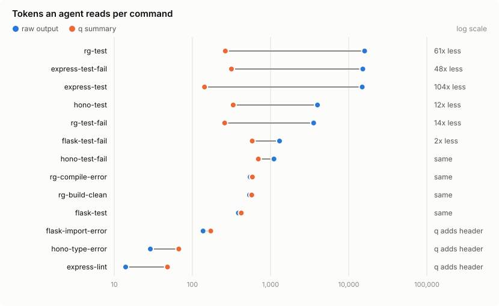

# qcap

`q` runs a command for a coding agent. It keeps the command's exit code, saves the full output
to a log file, and prints a short summary: one header line, the first error, and the last 15
lines. When the output is short and the command succeeded, it prints just the output.

```console
$ q cargo test --workspace
q: exit 101 · 0.7s · 323 lines · log /tmp/q/cargo-test-4.log
-- first error: line 307 --
304:
305: ---- tests::empty_set_works stdout ----
306:
307: thread 'tests::empty_set_works' panicked at crates/globset/src/lib.rs:1158:9:
308: assertion failed: set.is_match("a")
-- last lines: 309-323 --
...
test result: FAILED. 290 passed; 2 failed; 0 ignored; 0 measured; 0 filtered out
error: test failed, to rerun pass `-p globset --lib`
```

The full output is still in the log. `q show 280-320` prints a numbered slice of it, so the agent
can read more without running the command again.

## Why

Agents usually deal with long command output in one of two ways, and both have a cost.

- **`cmd 2>&1 | tail -20`**: the shell reports `tail`'s exit code, which is 0, so a failing test
  run looks like a pass. When the first error is above the last 20 lines, it never reaches the
  agent.
- **The full output**: a test suite can print thousands of lines. All of it goes into the context
  window, and the agent pays for it on every later turn.

`q` keeps the exit code and the first error and leaves the rest in a file.

## Measurements

We ran 13 commands once each through `q` on four widely used open-source projects, each pinned
to a fixed commit: [ripgrep](https://github.com/BurntSushi/ripgrep) (Rust, cargo),
[hono](https://github.com/honojs/hono) (TypeScript, vitest and tsc),
[flask](https://github.com/pallets/flask) (Python, pytest) and
[express](https://github.com/expressjs/express) (JavaScript, mocha and eslint). Six runs are the
projects' own test, build and lint commands as they ship. The other seven fail on a bug we
injected: a broken assertion, a type error, a compile error or an import error. For each run we
counted the tokens in the raw output, in `tail -15` and `tail -50` of it, and in `q`'s summary.
We also checked whether each view contained the line that names the real failure.

<picture>
  <source media="(prefers-color-scheme: dark)" srcset="docs/bench-dark.svg">
  
</picture>

| view | tokens, all 13 runs | failure visible (7 failing runs) | exit code kept |
|---|---|---|---|
| raw output | 57,688 | 7/7 | yes |
| `tail -50` | 5,984 | 6/7 | no |
| **`q`** | **3,937** | **7/7** | **yes** |
| `tail -15` | 2,256 | 6/7 | no |

- **Long output gets much smaller.** express's mocha suite prints 1,972 lines, 14,903 tokens;
  `q` shows 143 (104x fewer). ripgrep's 1,404-line test run drops from 16,001 tokens to 264.
  Over all 13 runs, `q` uses 14.7x fewer tokens than the raw output.
- **A repeated failure shows once.** pytest and vitest print the same assertion message for every
  failing test and again in their closing summary. After the first failure, the error block skips
  a failure line it has already shown or that the tail will show. That cut hono's failing run
  from 698 tokens to 407.
- **Short output costs nothing extra when it passes.** When a command prints 55 lines or fewer
  and exits 0, `q` prints exactly its output, with no header. If it failed or was stopped, a short
  header comes first (`q: exit 4 · 0.4s · 12 lines`, about 16 tokens), because the exit code is
  the point. `q last` prints the log path either way. Six of the 13 runs were that short.
- **`tail` is cheaper but misses failures.** On hono, vitest named the failing test more than 50
  lines from the end, so `tail -15` and `tail -50` both missed it. `tail` also hides every exit
  code.
- **A failure can cost more than `tail -50`.** On a failing run `q` prints the error block (up to
  40 lines, `-n` changes it) and the tail. For flask's failing test that was 510 tokens against
  `tail -50`'s 486.

Per-run numbers are in [bench/results.md](bench/results.md). Tokens are counted with tiktoken's
`o200k_base` encoding as a stand-in, so absolute numbers differ from Claude's tokenizer. The
ratios between views hold. To reproduce (needs git, cargo, bun, npm, uv and jq):

```sh
bench/setup.sh /tmp/qbench                                   # clone the pinned repos, install deps
bench/run.sh bench/cases.tsv /tmp/qbench /tmp/qbench/out     # run each case through q
uv run bench/analyze.py /tmp/qbench/out                      # bench/results.*, docs/bench-*.svg
```

Add a line to `bench/cases.tsv` to measure your own commands.

## Install

Linux and macOS; CI runs the full test suite on both. Needs a Rust toolchain.

```sh
cargo install --git https://github.com/alia0209/qcap
```

Or from a clone: `make install` builds a release binary and links it to `~/.local/bin/q`.

Then tell your agent to use it. One line in `AGENTS.md` or `CLAUDE.md` is enough:

```md
Run tests, builds and anything with long output through `q` (`q cargo test`), never `| tail`.
Read more of a log with `q show A-B`.
```

## Usage

```sh
q cargo test                  # run, summarize, keep the exit code
q "make lint && make test"    # one argument with shell syntax runs through bash -c
q -t 100s bun test            # stop it after 100s and still print a summary
q -n 80 npm run validate      # allow an 80-line error block (default 40)
q --grep 'FAIL|panicked' cargo test
q --json cargo test | jq .first_error

q last                        # path of the newest log from this directory
q show 120-160                # numbered lines 120-160 of that log
q show -50                    # its last 50 lines
q show /tmp/q/x.log 1-40
```

### Exit codes

| code | meaning |
|---|---|
| the command's | it ran to the end |
| 128+N | killed by signal N |
| 124 | stopped by `q`: `-t` timeout, or output passed 512 MiB |
| 125 | `q` itself failed (for example, it could not create the log) |
| 127 | command not found |
| 2 | bad `q` usage |

### Finding the first error

`q` first looks for strong signals: `panicked`, `error:`, `error[E0308]`, `error TS2322`,
`SomethingError`, `Traceback`, `assert`, `FAIL` at the start of a line, TAP `not ok`, `✗`. If
there are none, it falls back to any line where `error` or `fail` starts a word. Lines like
`0 failed`, `test foo ... ok` and `✓` never count. The error block is the matches with 3 lines
of context, limited to `-n` lines and only from above the tail. A match whose text the block
already shows, or that the tail repeats, starts no new group (the first failure always shows).
The block prints only when the command failed.

### Agent harness timeouts

Agent harnesses kill commands that run too long. `q` handles that:

- When `q` gets SIGTERM, SIGINT or SIGHUP, it passes the signal to the command's whole process
  group, sends SIGKILL a second later, and still prints its summary.
- A run longer than 10 seconds prints `q: still running · log <path>` first. If `q` is killed
  with SIGKILL, the log path is still on screen.
- `-t DUR` stops the command before the harness does, so the summary always prints.

### Output handling

ANSI color codes are stripped, only the last frame of `\r` progress bars is kept, and lines
longer than 400 characters are cut. Binary output prints as one line. The log file is the raw,
unchanged output. `q` reads the log in one streaming pass and keeps only what it may print, so
summarizing a 500 MiB log takes about 5 MB of memory. `/tmp` is often RAM-backed, so `q` stops a
command once its log passes 512 MiB.
Logs older than 2 days are deleted when a new one is created. `Q_DIR` changes the log directory.

### `--json`

`--json` prints a single object for tools: `exit`, `seconds`, `log`, `command`, `bytes`, `lines`,
`binary`, `stopped` (timeout, signal or output cap), `killed_by`, `complete`, `first_error`,
`error_block`, `more_errors`, `tail` and `grep`. Line entries are `{line, text}`, 1-based.

## Claude Code hook

`q hook` is an optional PreToolUse hook. When the agent pipes a test, build, lint or validate
command through `head` or `tail`, the hook adds a hint naming the `q` command to run instead. It
never blocks a command. Read-only commands (`rg`, `git log`, `ls`), heredoc bodies and quoted
strings don't trigger it. Each session gets the full hint once, then a one-line reminder up to
10 times, then nothing.

```json
{
  "hooks": {
    "PreToolUse": [
      { "matcher": "Bash", "hooks": [{ "type": "command", "command": "q hook" }] }
    ]
  }
}
```

`q hook --check "cargo test | tail -5"` explains the decision for one command.

## Development

`make validate` runs rustfmt, clippy, the unit tests, a release build and the black-box tests in
`test/cli.test.sh`. It needs `shellcheck`. [AGENTS.md](AGENTS.md) has the code map and the full
behaviour contract.

## License

[MIT](LICENSE)
